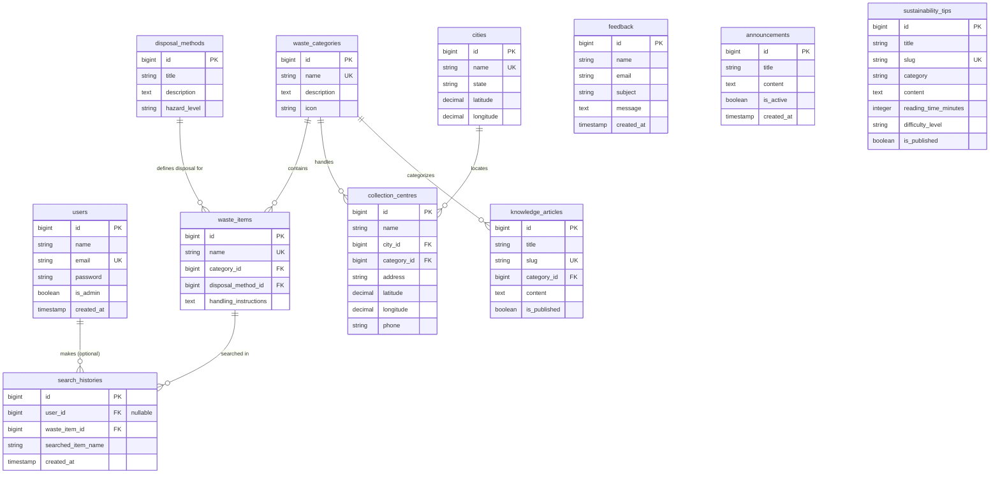

# WasteWise – Database Design & Schema Documentation

This document describes the complete relational database design, table schemas, entity relationships, constraints, and index definitions for the **WasteWise** application.

---

## 🧜 Entity-Relationship (ER) Diagram

---

## 📋 Table Schemas

### 1. `users`
- **Purpose**: Stores registered citizens and system administrators.
- **Primary Key**: `id` (bigint, auto-increment)

| Column | Data Type | Nullable | Default | Description / Constraints |
| :--- | :--- | :---: | :---: | :--- |
| `id` | `bigint` | No | Auto | Primary Key |
| `name` | `varchar(255)` | No | None | User's full name |
| `email` | `varchar(255)` | No | None | Unique user email address |
| `email_verified_at`| `timestamp` | Yes | `NULL` | Email verification timestamp |
| `password` | `varchar(255)` | No | None | Bcrypt hashed password |
| `is_admin` | `boolean` | No | `false` | Administrator role flag |
| `remember_token` | `varchar(100)` | Yes | `NULL` | Auth session token |
| `created_at` | `timestamp` | Yes | `NULL` | Creation timestamp |
| `updated_at` | `timestamp` | Yes | `NULL` | Modification timestamp |

---

### 2. `waste_categories`
- **Purpose**: Classifies waste types (e.g. Organic, E-Waste, Plastic, Hazardous).
- **Primary Key**: `id` (bigint, auto-increment)

| Column | Data Type | Nullable | Default | Description / Constraints |
| :--- | :--- | :---: | :---: | :--- |
| `id` | `bigint` | No | Auto | Primary Key |
| `name` | `varchar(255)` | No | None | Unique category name |
| `description` | `text` | Yes | `NULL` | Category explanation |
| `icon` | `varchar(255)` | Yes | `NULL` | Bootstrap / UI icon class name |
| `created_at` | `timestamp` | Yes | `NULL` | Creation timestamp |
| `updated_at` | `timestamp` | Yes | `NULL` | Modification timestamp |

---

### 3. `disposal_methods`
- **Purpose**: Outlines step-by-step procedures for disposing of waste.
- **Primary Key**: `id` (bigint, auto-increment)

| Column | Data Type | Nullable | Default | Description / Constraints |
| :--- | :--- | :---: | :---: | :--- |
| `id` | `bigint` | No | Auto | Primary Key |
| `title` | `varchar(255)` | No | None | Disposal method title |
| `description` | `text` | No | None | Comprehensive disposal procedure |
| `hazard_level` | `varchar(50)` | No | `'low'` | Hazard classification (`low`, `medium`, `high`) |
| `created_at` | `timestamp` | Yes | `NULL` | Creation timestamp |
| `updated_at` | `timestamp` | Yes | `NULL` | Modification timestamp |

---

### 4. `waste_items`
- **Purpose**: Master table of specific waste items searched by users.
- **Primary Key**: `id` (bigint, auto-increment)

| Column | Data Type | Nullable | Default | Description / Constraints |
| :--- | :--- | :---: | :---: | :--- |
| `id` | `bigint` | No | Auto | Primary Key |
| `name` | `varchar(255)` | No | None | Unique item name (e.g. "Plastic Bottle") |
| `category_id` | `bigint` | No | None | Foreign Key → `waste_categories(id)` (`CASCADE`) |
| `disposal_method_id`| `bigint` | No | None | Foreign Key → `disposal_methods(id)` (`CASCADE`) |
| `handling_instructions`| `text` | Yes | `NULL` | Specific handling cautions |
| `created_at` | `timestamp` | Yes | `NULL` | Creation timestamp |
| `updated_at` | `timestamp` | Yes | `NULL` | Modification timestamp |

---

### 5. `cities`
- **Purpose**: Municipal cities supported by the collection network.
- **Primary Key**: `id` (bigint, auto-increment)

| Column | Data Type | Nullable | Default | Description / Constraints |
| :--- | :--- | :---: | :---: | :--- |
| `id` | `bigint` | No | Auto | Primary Key |
| `name` | `varchar(255)` | No | None | Unique city name (e.g. "Surat") |
| `state` | `varchar(255)` | No | None | State name (e.g. "Gujarat") |
| `latitude` | `decimal(10,7)` | Yes | `NULL` | City center latitude |
| `longitude` | `decimal(10,7)` | Yes | `NULL` | City center longitude |
| `created_at` | `timestamp` | Yes | `NULL` | Creation timestamp |
| `updated_at` | `timestamp` | Yes | `NULL` | Modification timestamp |

---

### 6. `collection_centres`
- **Purpose**: Physical facilities accepting specific categories of waste.
- **Primary Key**: `id` (bigint, auto-increment)

| Column | Data Type | Nullable | Default | Description / Constraints |
| :--- | :--- | :---: | :---: | :--- |
| `id` | `bigint` | No | Auto | Primary Key |
| `name` | `varchar(255)` | No | None | Centre facility name |
| `city_id` | `bigint` | No | None | Foreign Key → `cities(id)` (`CASCADE`) |
| `category_id` | `bigint` | No | None | Foreign Key → `waste_categories(id)` (`CASCADE`) |
| `address` | `varchar(255)` | No | None | Physical street address |
| `latitude` | `decimal(10,7)` | Yes | `NULL` | Facility latitude coordinate |
| `longitude` | `decimal(10,7)` | Yes | `NULL` | Facility longitude coordinate |
| `phone` | `varchar(50)` | Yes | `NULL` | Contact telephone number |
| `created_at` | `timestamp` | Yes | `NULL` | Creation timestamp |
| `updated_at` | `timestamp` | Yes | `NULL` | Modification timestamp |

---

### 7. `search_histories`
- **Purpose**: Records public and user search events for analytics.
- **Primary Key**: `id` (bigint, auto-increment)

| Column | Data Type | Nullable | Default | Description / Constraints |
| :--- | :--- | :---: | :---: | :--- |
| `id` | `bigint` | No | Auto | Primary Key |
| `user_id` | `bigint` | Yes | `NULL` | Foreign Key → `users(id)` (`CASCADE`), null for guests |
| `waste_item_id` | `bigint` | No | None | Foreign Key → `waste_items(id)` (`CASCADE`) |
| `searched_item_name`| `varchar(255)` | No | None | Snapshot of searched text |
| `created_at` | `timestamp` | Yes | `NULL` | Creation timestamp |
| `updated_at` | `timestamp` | Yes | `NULL` | Modification timestamp |

---

### 8. `feedback`
- **Purpose**: Citizen inquiries and system feedback.
- **Primary Key**: `id` (bigint, auto-increment)

| Column | Data Type | Nullable | Default | Description / Constraints |
| :--- | :--- | :---: | :---: | :--- |
| `id` | `bigint` | No | Auto | Primary Key |
| `name` | `varchar(255)` | No | None | Submitter name |
| `email` | `varchar(255)` | No | None | Submitter email address |
| `subject` | `varchar(255)` | No | None | Feedback subject line |
| `message` | `text` | No | None | Detailed feedback content |
| `created_at` | `timestamp` | Yes | `NULL` | Creation timestamp |
| `updated_at` | `timestamp` | Yes | `NULL` | Modification timestamp |

---

### 9. `announcements`
- **Purpose**: Public municipal announcements and recycling drives.
- **Primary Key**: `id` (bigint, auto-increment)

| Column | Data Type | Nullable | Default | Description / Constraints |
| :--- | :--- | :---: | :---: | :--- |
| `id` | `bigint` | No | Auto | Primary Key |
| `title` | `varchar(255)` | No | None | Announcement title |
| `content` | `text` | No | None | Body content |
| `is_active` | `boolean` | No | `true` | Visibility flag |
| `created_at` | `timestamp` | Yes | `NULL` | Creation timestamp |
| `updated_at` | `timestamp` | Yes | `NULL` | Modification timestamp |

---

### 10. `sustainability_tips`
- **Purpose**: Daily educational tips for sustainable living.
- **Primary Key**: `id` (bigint, auto-increment)

| Column | Data Type | Nullable | Default | Description / Constraints |
| :--- | :--- | :---: | :---: | :--- |
| `id` | `bigint` | No | Auto | Primary Key |
| `title` | `varchar(255)` | No | None | Tip title |
| `slug` | `varchar(255)` | No | None | Unique URL slug |
| `category` | `varchar(255)` | No | None | Category grouping |
| `content` | `text` | No | None | Detailed tip content |
| `reading_time_minutes`| `integer` | No | `2` | Calculated reading time |
| `difficulty_level`| `varchar(50)` | No | `'Easy'` | Difficulty level |
| `is_published` | `boolean` | No | `true` | Publication status |
| `created_at` | `timestamp` | Yes | `NULL` | Creation timestamp |
| `updated_at` | `timestamp` | Yes | `NULL` | Modification timestamp |

---

### 11. `knowledge_articles`
- **Purpose**: In-depth educational articles in the Knowledge Hub.
- **Primary Key**: `id` (bigint, auto-increment)

| Column | Data Type | Nullable | Default | Description / Constraints |
| :--- | :--- | :---: | :---: | :--- |
| `id` | `bigint` | No | Auto | Primary Key |
| `title` | `varchar(255)` | No | None | Article title |
| `slug` | `varchar(255)` | No | None | Unique URL slug |
| `category_id` | `bigint` | No | None | Foreign Key → `waste_categories(id)` (`CASCADE`) |
| `content` | `text` | No | None | Article body markdown/text |
| `is_published` | `boolean` | No | `true` | Publication status |
| `created_at` | `timestamp` | Yes | `NULL` | Creation timestamp |
| `updated_at` | `timestamp` | Yes | `NULL` | Modification timestamp |

---

## 📐 Normalization Notes
- The database satisfies **Third Normal Form (3NF)**:
  1. **1NF**: All table columns contain atomic values; no multi-valued arrays are stored.
  2. **2NF**: Non-key attributes depend on the complete primary key.
  3. **3NF**: Non-key attributes contain no transitive dependencies (e.g. Collection Centre addresses reference `city_id` foreign keys rather than storing state/city strings redundantly).
