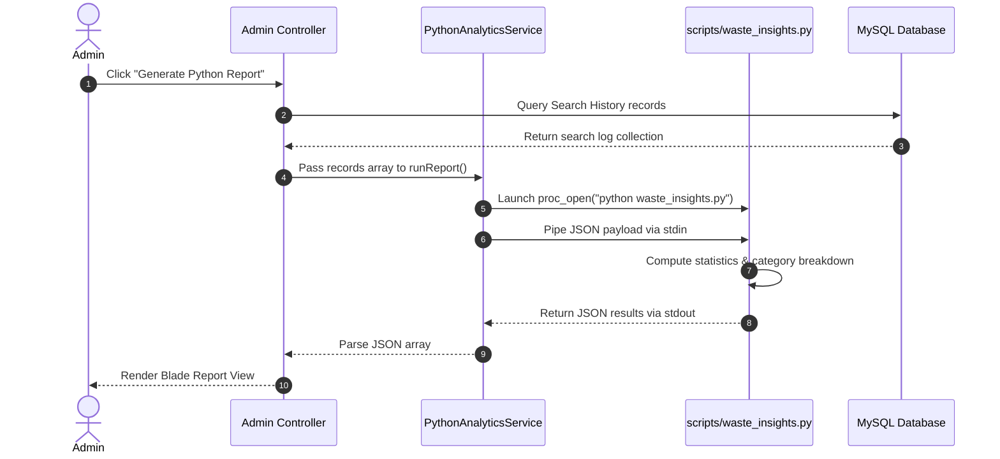
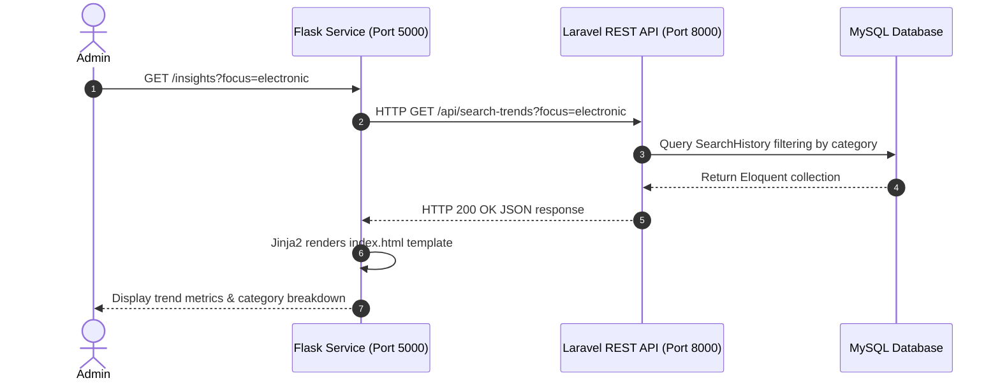
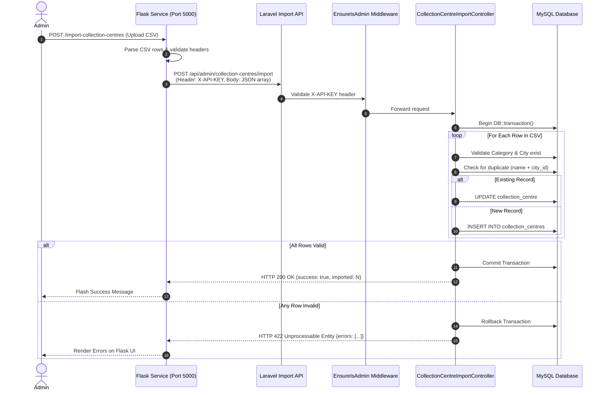
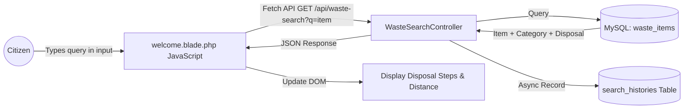

# WasteWise – System Architecture Documentation

This document describes the high-level system architecture, service integration, request processing flows, data pipelines, and architectural principles implemented in **WasteWise**.

---

## 🏗️ 1. High-Level Architecture Overview

WasteWise uses a **decoupled, service-oriented architecture (SOA)** combining a primary **PHP / Laravel 11** core web application with a secondary **Python / Flask 3.1** microservice.

```mermaid
graph TD
    Client[Browser / End User] -->|HTTP GET/POST| Laravel[Laravel Web Application Port 8000]
    Client -->|HTTP GET/POST| Flask[Python Flask Service Port 5000]

    subgraph Laravel Ecosystem
        Laravel -->|Eloquent ORM| MySQL[(MySQL Database)]
        Laravel -->|Subprocess proc_open - Unit 4| PythonCLI[scripts/waste_insights.py]
    end

    subgraph Flask Ecosystem
        Flask -->|REST API HTTP GET/POST - Unit 5| LaravelAPI[Laravel REST API /api/...]
    end

    LaravelAPI -->|Query / Transaction| MySQL
```

### Key Architectural Principles
1. **Single Source of Truth**: The MySQL database is owned and managed exclusively by the Laravel core application.
2. **No Direct Microservice Database Access**: Flask does **not** connect directly to MySQL; it interacts with data solely through HTTP REST APIs exposed by Laravel.
3. **Decoupled Responsibilities**:
   - **Laravel**: Handles UI rendering, user auth, business logic, CRUD management, API endpoints, and database transactions.
   - **Flask**: Handles specialized data analysis, custom CSV processing, interactive trend reporting, and CSV import staging.

---

## 🔁 2. Component Integration Flows

### Flow A: PHP → Python CLI Integration (Course 504 - Unit 4)
When an administrator triggers a Python analytics report from the Laravel Admin Dashboard:

---

### Flow B: Flask → Laravel REST API Integration (Course 504 - Unit 5)
When an administrator accesses the Flask Insights portal to inspect search trends:

---

### Flow C: Collection Centre CSV Bulk Import Pipeline
When an administrator uploads a CSV file through the Flask Service interface to import new collection centres into Laravel:

---

## 🔍 3. Core Application Workflows

### 1. Citizen Live Waste Search Flow (AJAX)

### 2. Geolocation Finder Flow (Haversine Distance)
1. User provides coordinates `(user_lat, user_lng)` or selects a city.
2. Client JavaScript fetches collection centres from backend payload.
3. Client executes Haversine distance formula for each centre:
   $$d = 2r \arcsin\left(\sqrt{\sin^2\left(\frac{\Delta \phi}{2}\right) + \cos(\phi_1)\cos(\phi_2)\sin^2\left(\frac{\Delta \lambda}{2}\right)}\right)$$
4. Sorts centres by distance (km) and updates UI listing nearest facilities.

---

## 🛡️ 4. Security Architecture

1. **Web Authentication**: Session-based auth using encrypted cookies and Laravel `Auth` guard.
2. **API Authentication**: Dual-mode protection in `EnsureIsAdmin.php`:
   - Checks active web admin session (`auth()->check() && auth()->user()->is_admin`).
   - OR verifies request header `X-API-KEY` matches `config('app.admin_api_key')`.
3. **Database Transaction Isolation**: Ensures all bulk imports complete atomically using MySQL InnoDB transactions (`DB::transaction`).
4. **Input Sanitation & Escaping**:
   - Blade templates use double curly braces `{{ $value }}` for automatic HTML entity escaping.
   - SQL queries use PDO parameter bindings to eliminate SQL Injection risks.
